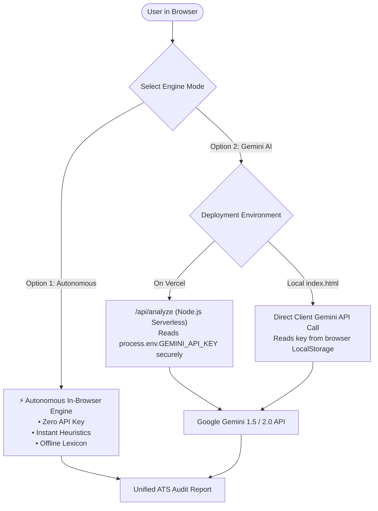

# CareerPilot.ai — Dual-Engine AI Career Copilot & ATS Resume Auditor

[](https://vercel.com/new)


> **AI Career Copilot — Engineer Your First LLM Product**  
> A production-grade web application equipped with **Dual-Engine Analysis**:
> 1. **⚡ Autonomous Analysis (Client-Side & Offline):** Runs 100% in-browser with zero API key required, zero latency, and deterministic ATS heuristics.
> 2. **🤖 Gemini AI Analysis (Cloud LLM):** Powered by Google Gemini 1.5/2.0 API with prompt engineering, deep contextual reasoning, and Google XYZ bullet point rewrites.

---

## ⚡ The Dual-Engine Architecture

| Feature | ⚡ Option 1: Autonomous Engine | 🤖 Option 2: Gemini AI Engine |
|---|---|---|
| **API Key Required?** | ❌ **No (Zero setup)** | ✅ Yes (Free key or Vercel env) |
| **Execution Location** | 100% In-Browser (Edge) | Cloud (Google Gemini API / Vercel Serverless) |
| **Execution Latency** | Instant (< 50ms) | 2–4 seconds (LLM inference) |
| **Internet Required?** | ❌ Works completely offline | ✅ Requires internet connection |
| **Core Mechanism** | N-gram tokenization, TF-IDF frequency, Lexicon matching, Regex metric detection | Deep Prompt Engineering (ROLE + TASK + FORMAT + RULES), LLM Context |
| **Bullet Point Rewriting** | Rule-based Google XYZ formula | Generative contextual XYZ synthesis |
| **Rate Limit Risk** | 0% (Unlimited runs forever) | 1,500 free requests/day |

---

## 🌟 Key Features

### 1. Dual Analysis Modes
- Toggle easily with one click between **Autonomous Engine** (instant offline) and **Gemini AI Engine** (cloud LLM).
- **Intelligent Fallback:** If you choose Gemini AI mode without an API key or encounter rate limits, the app seamlessly switches to Autonomous mode so you are never left blocked!

### 2. Advanced Prompt Engineering & Universal Personas (ROLE + TASK + FORMAT + RULES)
- **Universal Multi-Persona AI System (Analyzes All Jobs & Industries):**
  - 🌐 **Universal Recruiter (Default):** Cross-industry talent acquisition partner evaluating comprehensive role fit, domain terminology, and verified achievements for ANY job in any field (Healthcare, Business, Finance, Tech, Legal, Creative, Operations).
  - 💻 **Tech Recruiter (Tier 1):** Focuses on technical stack alignment, system architecture impact, algorithmic strength, and quantifiable engineering metrics.
  - 📈 **Business, Marketing & Sales Specialist:** Prioritizes revenue generation, pipeline growth, ROI, campaign metrics, customer retention, and commercial leadership.
  - 🏥 **Healthcare & Clinical Recruiter:** Evaluates clinical competencies, patient care outcomes, regulatory compliance, HIPAA, and medical licensures.
  - ⚖️ **Finance, Accounting & Legal Lead:** Assesses GAAP/IFRS standards, financial modeling, fiduciary audits, risk mitigation, and compliance.
  - 🎓 **Fresh Graduate & Early-Career Advisor:** Emphasizes academic coursework, capstones, research, hackathons, GPA, internships, and rapid learnability.
  - 🔄 **Career Pivot & Transferable Skills Strategist:** Prioritizes framing non-linear trajectories, extracting universal transferable hard and soft skills, and bridging domain gaps.
  - 👔 **Executive & Leadership Search Partner:** Evaluates P&L ownership, organizational leadership, strategic vision, and enterprise business outcomes.
  - ✏️ **Custom Persona (User-Defined):** Define your own specialized recruiter lens or custom evaluation criteria in real time.
- **Strict Structured JSON Output:** Uses native JSON schema constraints (`response_mime_type: "application/json"`) to ensure 100% reliable parsing without markdown errors.

### 3. Actionable ATS Evaluation
- **Calibrated Scoring Engine (0-100):** Weighted sub-scores for Keyword Match, Experience Fit, Technical Skills Alignment, and Formatting.
- **Diagnostic Keyword Gap:** Identifies exact missing keywords present in the JD but omitted from the resume, plus confirmed matched keywords with 1-click clipboard copy.
- **Skill Gap Matrix:** Categorizes skills into Verified Hard Skills, Missing Technical Skills, and Missing Soft Competencies.
- **🔍 Proof of Work & Verifiability Audit:** Evaluates claims that lack measurable evidence, benchmark numbers, or live verification. Computes a 0–100% Verifiability Score.
- **🐙 GitHub & Project Repository Audit:** Automatically verifies whether public GitHub profile links and direct project repository links are provided for recruiter code review.
- **⚙️ Technical Specifications Depth Matrix:** Pinpoints surface-level mentions that lack engineering specifications (Scale & Throughput QPS/SLAs, Architecture & Infrastructure topology, Testing & CI/CD coverage).
- **🔗 Evidence Artifacts Checklist:** Flags missing proof links (Live Deployed URLs on Vercel/Render, GitHub repos, API documentation, system architecture diagrams).
- **Salary Guidance:** Provides estimated market compensation range and seniority level match.

### 4. Google XYZ Bullet Point Rewriter
- Transforms weak, passive bullets into high-impact, quantifiable bullets following Google's formula:
  > *"Accomplished [X] as measured by [Y], by doing [Z]"*
- Generates a clear recruiter rationale for every rewrite with 1-click copy.

### 5. ✨ AI Resume Builder & 10 Best Templates Studio
- **Auto-Synthesized Optimized Resume:** Takes the candidate's original resume, injects all missing keywords and technical specifications, upgrades bullet points with the Google XYZ formula, and attaches GitHub repository and live demo links.
- **10 Industry-Standard Professional Templates:**
  1. 🎓 **Harvard Classic:** Traditional academic & Wall Street / Big Tech standard (high ATS scan rate, clean serif/sans hybrid, centered header).
  2. ⚡ **Silicon Valley Modern:** Startup & Tier-1 tech format (emerald skill pills, bold roles, clean modern typography).
  3. 💼 **Executive Leader:** Director & VP strategic layout (dark gradient header, 3-column boxed competency matrix).
  4. 📐 **Minimalist Linear:** Stripe & Raycast aesthetic (monospace timestamps, hairline borders, refined white space).
  5. 📊 **Two-Column Professional:** Compact European & tech sidebar (30% sidebar for Contact/Skills/Edu, 70% main for Experience).
  6. 🎨 **Modern Indigo Tech:** Indigo accents with timeline markers and styled badges.
  7. 🛡️ **ATS High-Density:** Strict single-column, zero-table, zero-float format for 100% robot compatibility.
  8. 🚀 **Compact One-Pager:** Engineered line-heights and padding calibrated to fit on a single printed sheet.
  9. ☁️ **Cloud Architect & DevOps:** Specialized Infrastructure & Scale matrix (QPS, p95 SLAs, uptime, test coverage).
  10. ❄️ **Nordic Clean:** Scandinavian minimalist typography with wide tracking and elegant letter-spacing.
- **Live In-Browser Editing:** The entire resume canvas has `contenteditable="true"` so candidates can edit or fine-tune any line before export.
- **Color Accent Picker & Spacing Selector:** Customize with Emerald, Indigo, Slate, Navy, or Rose accents, and adjust spacing (Compact, Normal, Spacious).
- **1-Click Export:** Native Print / Download as PDF (`@media print` formatted for 8.5" x 11" and A4), plus Copy as Markdown.

### 6. Advanced Production Features (+10 XP)
- 📊 **Interactive Bar & Pie Chart Diagnostics (Left Column):** After every scan, an interactive visual analytics panel dynamically renders:
  - **Competency Bar Chart:** Comparing Keyword Match %, Experience Fit %, Tech Stack Alignment %, ATS Formatting %, and Recruiter Impact %.
  - **Skill Gap Doughnut / Pie Chart:** Visualizing the exact ratio of Matched Skills vs. Missing Hard Skills vs. Missing Soft Competencies.
  - Interactive tabs to toggle between Bar and Pie view with theme-aware styling.
- 📄 **In-Browser PDF Resume Upload:** Integrated with `pdf.js` for instant client-side text extraction (no server storage, privacy safe).
- 💾 **Analysis History Drawer:** Stores up to 20 past audits in `localStorage` with scores, timestamps, engine tags, and 1-click restore.
- 🌓 **Dark Mode & Light Mode:** System-aware theme switcher with persistent local storage.
- 🖨️ **Export to PDF & Markdown:** Custom print layout (`@media print`) and 1-click copy full report as Markdown.
- 🎯 **One-Click Sample Datasets:** Quick-load buttons for Software Engineer, Fresh Grad, Data Scientist, and Product Manager.
- ⚡ **Multi-Model Selector:** Switch between `gemini-1.5-flash`, `gemini-1.5-pro`, and `gemini-2.0-flash`.

---

## 🏗️ Architecture & Security



1. **Autonomous Mode:** Requires zero backend or API key. Runs client-side deterministic algorithms.
2. **Production Mode (Vercel):** The serverless function [`api/analyze.js`](api/analyze.js) reads `process.env.GEMINI_API_KEY` securely on the server without exposing the key in the client bundle.
3. **Local Standalone Mode:** Enter your key into the built-in Settings modal (stored only in your browser's private `localStorage`).

---

## 🚀 Quick Start (Run Locally)

### Option 1: Instant Browser Launch (Zero Install)
1. Double click `index.html` or open it with Google Chrome / Edge / Firefox.
2. Select **⚡ Autonomous Engine** and click any **"Load Sample"** button (e.g. `💻 Software Eng`).
3. Click **"Analyze Autonomously (Instant Offline)"** — results appear instantly without needing any API key!
4. To test with Gemini LLM, click **Settings**, enter your Gemini API key from [Google AI Studio](https://aistudio.google.com), switch to **🤖 Gemini AI Engine**, and analyze.

### Option 2: Local HTTP Server
```bash
# Using Python
python -m http.server 8000

# Or using Node.js / npx
npx serve .
```
Open `http://localhost:8000`.

---

## 🌐 Deploy to Vercel (100% Free & Permanent)

### Step 1: Push to GitHub
1. Go to [github.com/new](https://github.com/new) and create a repository named `ai-career-copilot`.
2. Drag and drop all files from this directory into GitHub (or push via Git) and commit.

### Step 2: Import into Vercel
1. Go to [vercel.com](https://vercel.com) and click **"Add New" → "Project"**.
2. Select your `ai-career-copilot` repository and keep the preset as **Other**.
3. Under **Environment Variables**, add:
   - **Name:** `GEMINI_API_KEY`
   - **Value:** `AIzaSy...` (Your Gemini API Key)
4. Click **Deploy**. In under a minute, your product is live permanently at `https://ai-career-copilot-yourname.vercel.app`!

---

## 🧪 Systematic Testing & Evaluation (5 Real Resumes)

A full testing evaluation report is included in [`samples/EVALUATION_REPORT.md`](samples/EVALUATION_REPORT.md).

| # | Candidate & Target JD | ATS Score | Verdict | Key Finding |
|---|---|---|---|---|
| 1 | Full-Stack SWE vs Senior Cloud JD | **68 / 100** | Potential Match | Accurately flagged missing Kubernetes, Kafka & AWS ECS |
| 2 | CS Fresh Grad vs Associate SWE JD | **84 / 100** | Strong Match | Rewarded high GPA, hackathons & projects; flagged TDD |
| 3 | Data Analyst vs Data Scientist JD | **54 / 100** | High Risk / Low Match | Penalized missing PyTorch, XGBoost & MLOps experience |
| 4 | Product Manager vs Platform API PM | **62 / 100** | Potential Match | Identified absence of OpenAPI schemas & developer tooling |
| 5 | DevOps Engineer vs SRE Specialist | **89 / 100** | Strong Match | High alignment with Kubernetes, Terraform & Prometheus |

---

## 📁 Repository Structure

```
ai-career-copilot/
├── index.html                   # Main single-page application (Dual-Engine, Tailwind, PDF.js)
├── api/
│   └── analyze.js               # Vercel Serverless Function (Secure Gemini API proxy)
├── samples/                     # 5 test resume + job description datasets
│   ├── 01_software_engineer.md
│   ├── 02_fresh_graduate.md
│   ├── 03_data_scientist.md
│   ├── 04_product_manager.md
│   ├── 05_devops_engineer.md
│   └── EVALUATION_REPORT.md     # Detailed prompt evaluation & iteration rubric
├── package.json                 # Project manifest
├── vercel.json                  # Vercel routing configuration
└── README.md                    # Complete documentation & deployment guide
```

---

## 📝 Submission Information
- **Live Vercel URL:** [Provide your deployed Vercel URL here]
- **GitHub Repository:** [Provide your repository URL here]
- **Dual-Engine Feature:** Autonomous In-Browser ATS Engine (Zero API Key) + Google Gemini AI Cloud Engine.
- **Prompt Engineering Focus:** Multi-Persona ATS Diagnostic with Google XYZ Bullet Rewriting and Structured JSON Schema.
- **Bonus XP Features Completed:** PDF resume upload (`pdf.js`), Analysis History with LocalStorage, Export to Markdown & PDF, Multi-Model Selector, and 5-dataset evaluation suite.
